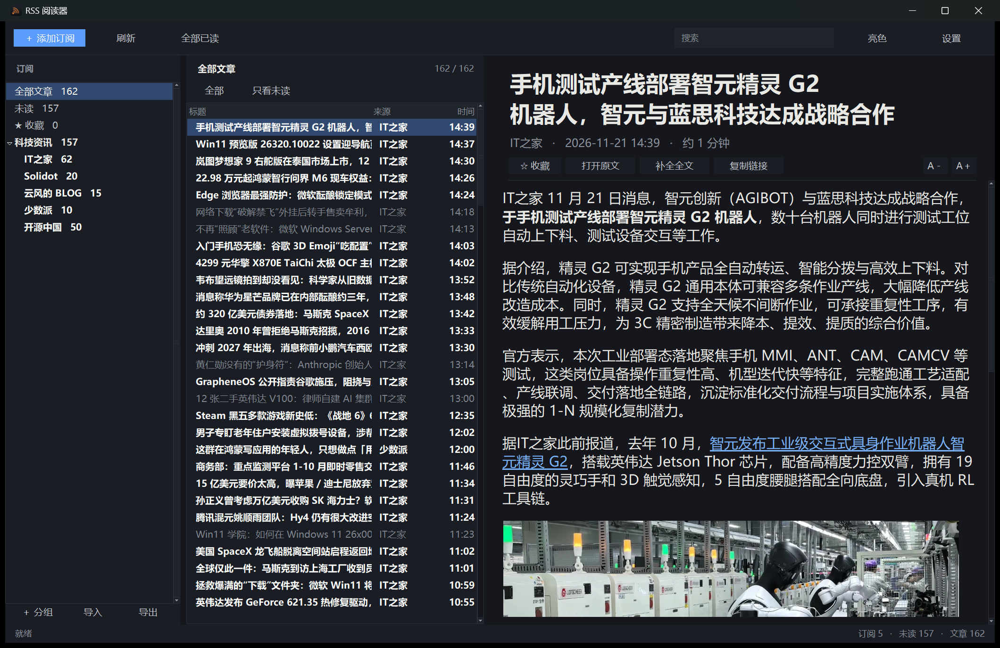
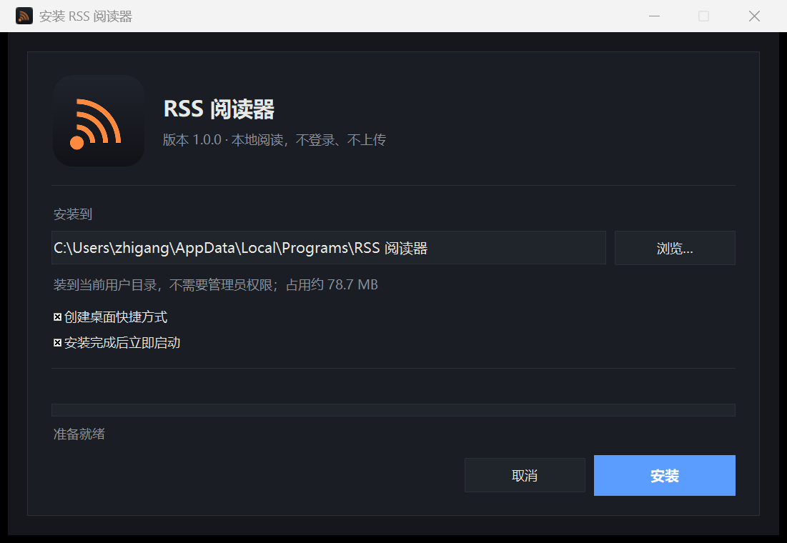
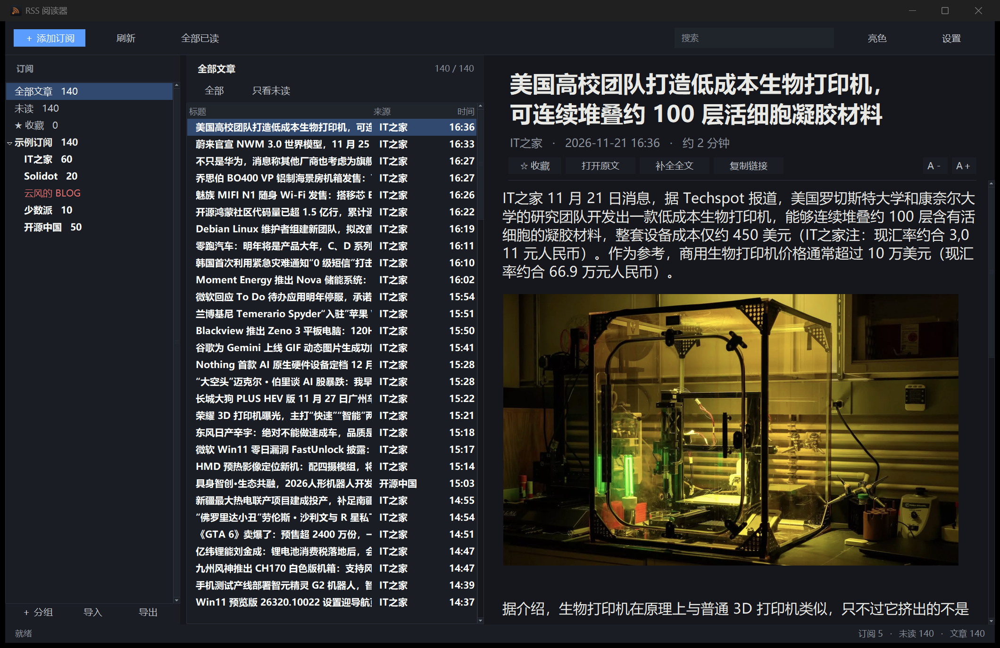
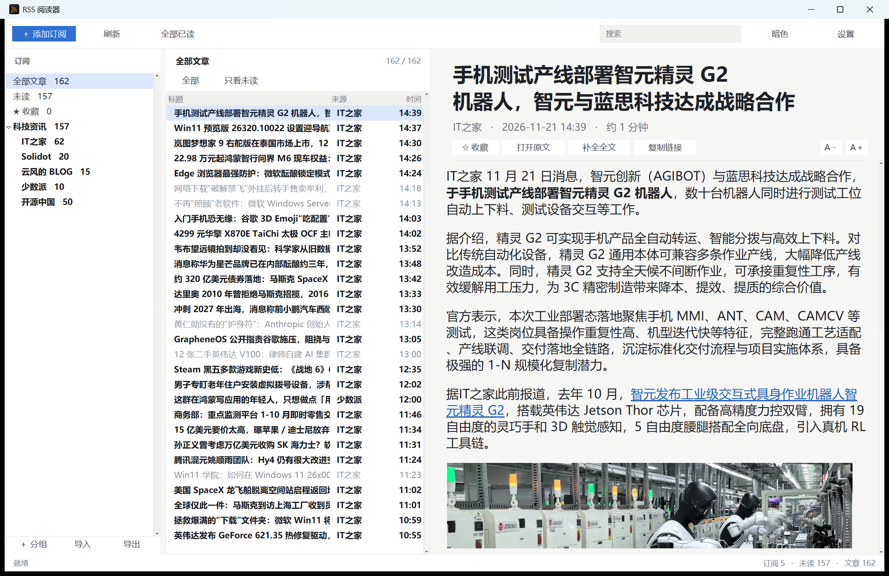
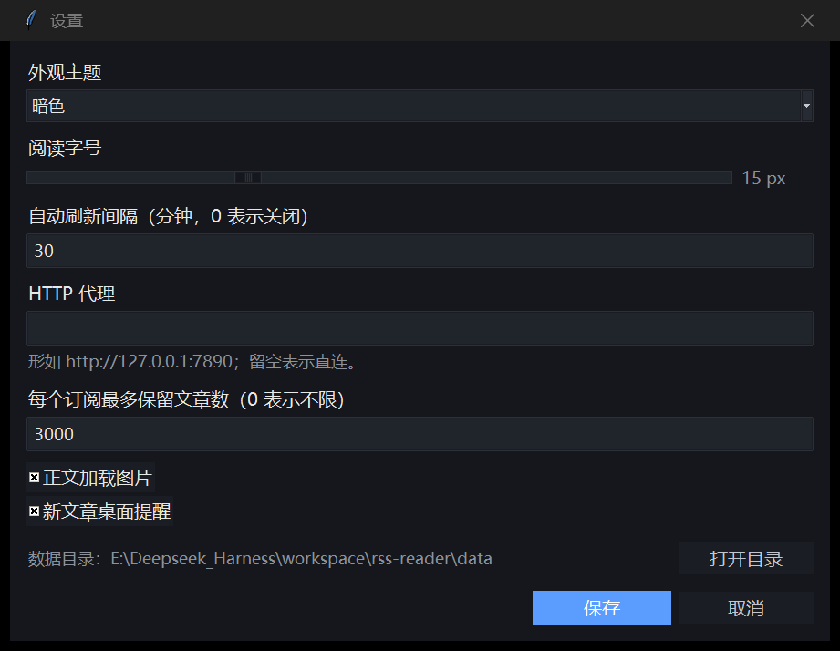
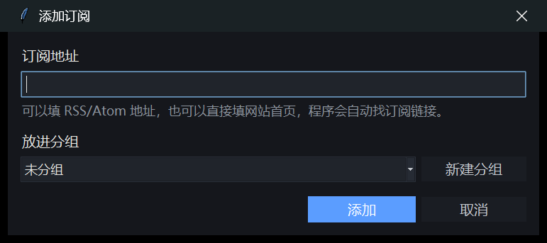

# RSS 阅读器（Windows）

一个本地 RSS 阅读器：三栏布局、订阅分组、未读管理、收藏、搜索、OPML 导入导出、定时刷新、暗色/亮色主题，正文里的图片也能直接显示。两种用法：**装成一个正常的 Windows 程序**，或者直接跑源码。



## 安装版（推荐，不需要 Python）

**直接下载安装包**：[Releases · v1.0.0](https://github.com/jinghuaiwan/RSS-/releases/latest) → `RSSReader-1.0.0-Setup.exe`（约 50 MB，已内置 Python 与依赖）。

自己打包的话，双击 `dist\安装RSS阅读器.exe`（构建方式见文末「重新打包 exe」）。安装界面长这样：



- 装到 `%LOCALAPPDATA%\Programs\RSS 阅读器`，**不需要管理员权限**，也不写系统目录。
- 自动创建开始菜单项和桌面快捷方式，并在「设置 → 应用 → 已安装的应用」里登记卸载项。
- 数据存在 `%APPDATA%\DSRssReader`（`reader.db` 与 `cache/` 图片缓存），**卸载不会删数据**，重装后订阅和已读状态都还在。
- 卸载：开始菜单 →「RSS 阅读器」右键 → 卸载，或「设置 → 应用」里卸载；也可以运行 `RSS阅读器.exe --uninstall`。
- 想带着数据走：把程序目录里放一个空的 `portable.txt`，数据就会写在程序目录的 `data\` 下，不再用 `%APPDATA%`。
- 命令行静默安装（给脚本用）：`安装RSS阅读器.exe --silent [--dir "目标目录"] [--no-desktop] [--launch]`。

第一次启动会自动加好「示例订阅」分组（少数派、IT之家、开源中国、Solidot、云风的 BLOG）并拉取文章，删掉即可。



<details>
<summary>亮色主题 / 设置 / 添加订阅</summary>







</details>

## 从源码运行

1. 双击 **`启动RSS阅读器.bat`**。
2. 第一次打开是空库，点左上角 **＋ 添加订阅**，把 RSS/Atom 地址粘进去（也可以直接粘网站首页，程序会自动找订阅链接）。
3. 想先看点内容？把下表的地址粘进「添加订阅」就行：

| 源 | 地址 |
| --- | --- |
| 少数派 | `https://sspai.com/feed` |
| IT之家 | `https://www.ithome.com/rss/` |
| 开源中国 | `https://www.oschina.net/news/rss` |
| Solidot | `https://www.solidot.org/index.rss` |
| 云风的 BLOG | `https://blog.codingnow.com/atom.xml` |

### 关于 Python

程序只用 **Python 标准库 + `lxml` + `Pillow`**（tkinter 自带）。`.bat` 会按下面的顺序找解释器：

1. 本目录下的 `python\pythonw.exe`（想把便携版 Python 丢进来就放这里）；
2. `%USERPROFILE%\.dsh\dsh-runtimes\dsh-primary-runtime\dependencies\python\pythonw.exe`（本机开发时用的那个）；
3. `PATH` 里的 `pythonw.exe`。

想用自己的 Python，只要装好依赖即可：

```bat
pip install lxml pillow
python run.py
```

> 直接命令行跑 `python run.py` 会把日志打在终端里，方便看错误；`.bat` 用的是 `pythonw.exe`，不弹黑框，崩溃信息写到 `data\reader.log`。

## 功能

- **三栏**：左订阅树（全部/未读/收藏/分组/单源）、中间文章列表、右侧阅读区；两处分隔条可拖动，宽度和窗口大小会记住。
- **订阅管理**：添加时自动探测订阅地址（RSS/Atom/RDF 都支持）、新建分组、重命名、移动到分组、删除（连带删除文章）；右键菜单里还可以单独刷新某个源。
- **未读与收藏**：未读加粗、已读变灰；点开即标已读（列表自动选中的第一篇不算）；★ 收藏可筛选。
- **搜索**：顶部搜索框实时过滤（标题/摘要/正文，支持 `%`、`_` 转义），Esc 清空。
- **正文阅读**：标题/作者/时间/预计阅读时长、图片（异步加载 + 磁盘缓存 + 失败占位）、代码块、引用、列表、表格、可点击链接。
- **补全全文**：源只给摘要时，点「补全全文」抓原网页正文并缓存。
- **OPML**：导入/导出，兼容市面常见阅读器。
- **刷新**：启动时刷一次，之后按设置间隔（默认 30 分钟）自动刷新；支持 ETag / Last-Modified 条件请求，省流量。
- **主题**：暗色默认，标题栏也跟着变深；一键切亮色，字号可调。
- **通知**：新文章可选桌面提醒 + 任务栏闪烁。

## 快捷键

| 按键 | 作用 |
| --- | --- |
| `F5` | 刷新全部 |
| `Ctrl + N` | 添加订阅 |
| `Ctrl + F` | 定位到搜索框 |
| `Ctrl + ,` | 打开设置 |
| `Esc` | 清空搜索 |
| `J` / `K` | 列表里下一篇 / 上一篇 |
| `Enter` | 用浏览器打开当前文章 |

## 设置项

| 项 | 说明 |
| --- | --- |
| 外观主题 | 暗色 / 亮色 |
| 阅读字号 | 11–24 px，只影响阅读区（列表字号固定） |
| 自动刷新间隔 | 分钟，0 表示关闭 |
| HTTP 代理 | 形如 `http://127.0.0.1:7890`，留空直连 |
| 每个订阅保留文章数 | 超出后删最旧的，收藏的不删；0 表示不限 |
| 正文加载图片 | 关掉可省流量 |
| 新文章桌面提醒 | 气泡通知 |

## 数据放在哪

- **安装版**：`%APPDATA%\DSRssReader\`（`reader.db`、`cache\` 图片缓存、`reader.log`）。卸载保留，重装继续用。
- **源码版**：默认**便携模式**，`rss-reader\data\` 下；程序目录不可写时自动回退 `%APPDATA%\DSRssReader`。
- 安装版想改回便携：在程序目录里放一个空文件 `portable.txt`，数据就写到程序目录的 `data\`。

设置里能看到当前数据目录，也能一键打开。

## 项目结构

```
rss-reader/
├─ dist\安装RSS阅读器.exe   # 安装包（单文件，内置 Python 与依赖）
├─ 启动RSS阅读器.bat      # 源码版双击启动（找 pythonw，无黑框）
├─ run.py                 # 入口：DPI 感知、建库、起窗口、崩溃日志、--uninstall
├─ installer.py           # 安装程序：拷文件、建快捷方式、登记卸载项、进度条
├─ app/
│  ├─ config.py           # 路径、默认设置（exe 版 vs 源码版、便携/AppData 判定）
│  ├─ install_info.py     # 安装路径、开始菜单/桌面位置、注册表键
│  ├─ shortcuts.py        # 建/删 .lnk（WScript.Shell）、写 HKCU 卸载项
│  ├─ uninstall.py        # 卸载：删快捷方式、注销、延时删目录
│  ├─ theme.py            # 暗/亮配色、ttk 样式、字体、暗色标题栏
│  ├─ store.py            # SQLite 数据层（WAL + 线程锁），全部查询在这
│  ├─ fetcher.py          # HTTP（条件请求/代理/编码识别）、RSS/Atom 解析、正文提取、订阅探测
│  ├─ render.py           # HTML → tk.Text 渲染（标题/图片/链接/代码块/表格）
│  ├─ images.py           # 图片异步下载 + 缓存 + 缩放到阅读区宽度
│  ├─ opml.py             # OPML 导入导出
│  ├─ dialogs.py          # 添加订阅/设置/重命名/选择分组等弹窗
│  └─ ui.py               # 主窗口：三栏布局、列表、阅读区、刷新调度
├─ assets/                # app.ico / app-256.png
├─ tests/                 # 28 个单元/冒烟测试
├─ tools/                 # 开发辅助：截图、造演示数据、探测源、检查布局、拉 PyInstaller wheel
└─ shots/                 # 截图
```

## 重新打包 exe

```bat
:: 1) 依赖：PyInstaller 装在 vendor/ 里（tools\fetch_pyinstaller.py 下载 wheel 后解包）
:: 2) 先出程序目录（onedir）
set PYTHONPATH=%CD%\vendor
python -m PyInstaller --noconfirm --clean --windowed --name RSS阅读器 ^
  --icon assets\app.ico ^
  --add-data "assets\app.ico;assets" --add-data "assets\app-256.png;assets" ^
  run.py
:: 3) 再把程序目录塞进单文件安装包
python -m PyInstaller --noconfirm --clean --windowed --onefile --name 安装RSS阅读器 ^
  --icon assets\app.ico ^
  --add-data "dist\RSS阅读器;payload/app" ^
  --add-data "assets\app.ico;assets" --add-data "assets\app-256.png;assets" ^
  installer.py
```

产物在 `dist\`：`RSS阅读器\`（绿色目录版，可直接拷走运行）和 `安装RSS阅读器.exe`。

## 测试

```bat
cd rss-reader
python -m unittest discover -s tests
```

覆盖：数据层增删改查与排序/搜索转义/保留策略、RSS/Atom/RDF 解析与编码识别、链接绝对化、正文提取、OPML 往返、tk 渲染（含图片占位）、弹窗返回值、主窗口冒烟。

## 已知限制

- 只支持 Windows（用到了 `DwmSetWindowAttribute` 暗色标题栏、任务栏闪烁；其他平台会跳过这些调用）。
- 中文不分词，搜索是 `LIKE` 子串匹配（没用 FTS5，因为没有词典）。
- 需要登录/反爬的站点（如部分知乎、公众号）取不到正文，属正常现象。
- 极少数源被墙或线路不稳（例如 cnBeta、BBC 中文），会在订阅上标红并显示原因，重试即可。
